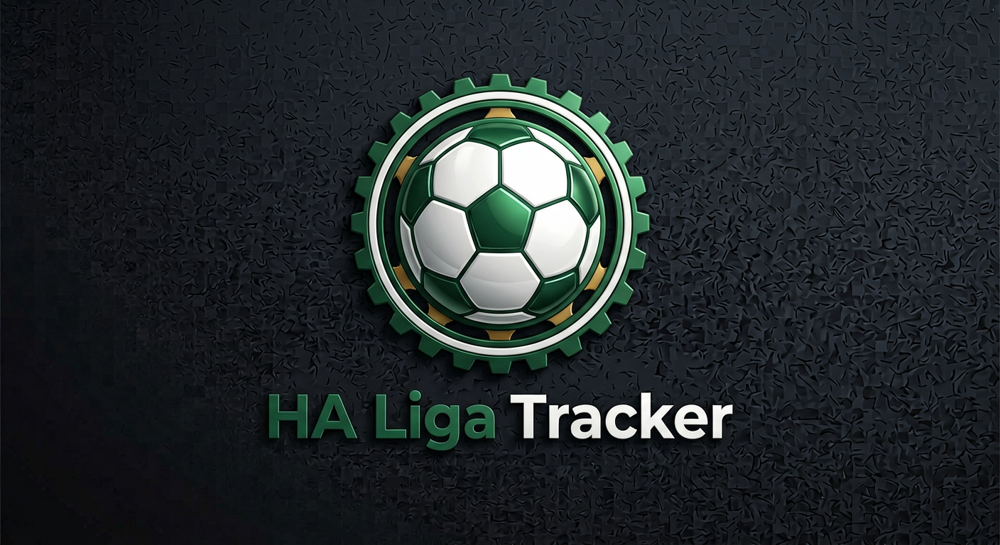

<p align="center">
  
</p>

# HA Liga Tracker

Fußball-Spielplan, Ergebnisse und Tabellenplätze deiner Lieblingsmannschaften in Home Assistant –
für Bundesliga, 2. Bundesliga, 3. Liga, DFB-Pokal, Champions League, Europa League, Conference
League und die Nationalmannschaft. Datenquelle ist [OpenLigaDB](https://www.openligadb.de)
(kostenlos, ohne API-Key, deutschsprachig).

## Einrichtung

Einstellungen → Geräte & Dienste → Integration hinzufügen → „HA Liga Tracker“.

1. **Mannschaften** wählen (eine oder mehrere). Alle Wettbewerbe, in denen die Mannschaft spielt
   (Liga, Pokal, Europapokal …), werden automatisch berücksichtigt.
2. **Ligen** (optional) wählen: Für jede gewählte Liga entsteht zusätzlich ein Kalender mit
   *allen* Partien dieser Liga.

Beides lässt sich später über „Konfigurieren“ ändern.

## Entitäten

Pro Mannschaft entsteht ein Gerät mit:

| Entität | Beschreibung |
|---|---|
| `calendar.<team>` | Alle Spiele der Mannschaft in allen Wettbewerben. Nach Abpfiff steht das Ergebnis im Titel (z. B. „VfB Stuttgart 1:1 Atletico Madrid“). |
| `image.<team>_vereinslogo` | Vereinslogo der Mannschaft (für Bild-Karten und eigene Dashboards). Dasselbe Logo dient als Entitätsbild der Team-Sensoren und steht als Attribut `team_logo` bereit. |
| `sensor.<team>_nachstes_spiel` | Anstoßzeit des nächsten Spiels; Attribute: Gegner, Wettbewerb, Spieltag, Heim/Auswärts. |
| `sensor.<team>_letztes_ergebnis` | Ergebnis des letzten Spiels aus Sicht der Mannschaft (eigene Tore zuerst, z. B. `2:1`); Attribut `result` = win/draw/loss. |
| `sensor.<team>_nachster_gegner`, `_nachster_wettbewerb` | Gegner und Wettbewerb des nächsten Spiels (z. B. „Borussia Mönchengladbach“, „Bundesliga“). Der Gegner-Sensor zeigt das Vereinslogo als Bild. |
| `sensor.<team>_letzter_gegner`, `_letzter_wettbewerb` | Gegner und Wettbewerb des letzten Spiels. |
| `sensor.<team>_nachstes_spiel_heim_auswarts`, `_letztes_spiel_heim_auswarts` | `Heimspiel` oder `Auswärtsspiel` für das nächste bzw. letzte Spiel. |
| `sensor.<team>_spielstatus` | `live` während eines Spiels, sonst `idle`; Attribut `score`. |
| `sensor.<team>_tabellenplatz_<wettbewerb>` | Tabellenplatz inkl. Punkte, Tore usw. (Ligen und Ligaphase der Europapokale). |

| `sensor.<team>_ubersicht` | Diagnose-Sensor mit allen Wettbewerben der Mannschaft als Attribut (Datenquelle der Karte). |

Pro gewählter Liga entsteht ein Gerät mit einem Kalender (`calendar.<liga>`) aller Partien.

## Mannschaftskarte

Die Integration bringt eine Lovelace-Karte mit, die beim Start automatisch geladen wird
(kein manuelles Eintragen unter „Ressourcen“). Sie zeigt pro Mannschaft: Name mit Logo, die Liga
mit Tabellenplatz sowie letztem und nächstem Spiel (mit Logos beider Mannschaften), darunter
„Weitere Wettbewerbe“ (DFB-Pokal, Europapokal …) mit demselben Aufbau.

```yaml
type: custom:ligatracker-team-card
entity: sensor.vfb_stuttgart_ubersicht   # Übersicht-Sensor der Mannschaft
name: VfB Stuttgart                      # optional
```

Im Karten-Editor erscheint sie als „Liga Tracker Mannschaftskarte“. Nach dem ersten Update
einmal hart neu laden (Strg+F5).

## Hinweise

- OpenLigaDB wird von der Community gepflegt. Ergebnisse stehen im Test wenige Minuten nach
  Abpfiff drin; **ob der Live-Stand während des Spiels aktualisiert wird, hängt von den
  Freiwilligen ab** und ist je Wettbewerb unterschiedlich.
- Während eines Spiels einer gewählten Mannschaft wird minütlich, sonst alle 15 Minuten
  aktualisiert. Liga-Kalender folgen dem 15-Minuten-Takt.
- Die OpenLigaDB-Kürzel sind nicht einheitlich (`ucl`, `uel2026`, …). Die Integration wählt je
  Wettbewerb automatisch das Kürzel mit den meisten Spielen.
